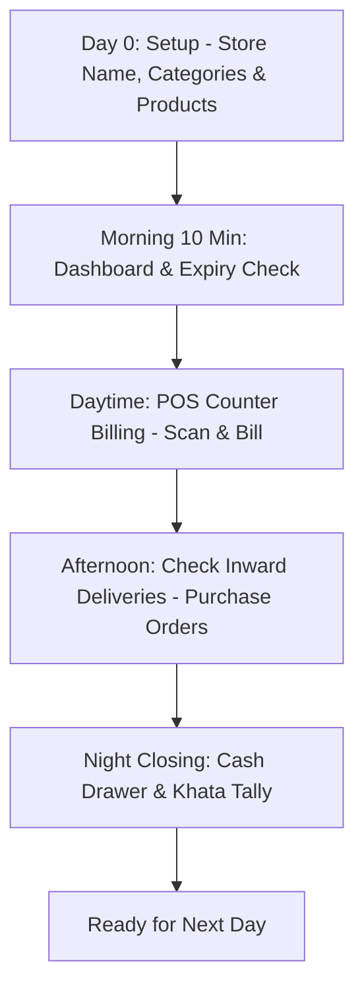

# 🛒 StockPilot — Beginner Shopkeeper Complete Guide & Feature Manual (Hinglish)
*A to Z Guide: Har Option Ka Asli Matlab, Kaam, Aur Rozana Dukaan Chalane Ka Step-by-Step Flow*

---

## 📌 Yeh Document Kiske Liye Hai?

Agar aapne StockPilot pehli baar khola hai aur screen par **30+ options, buttons, tables, alerts aur charts** dekh kar aapka sar chakra raha hai ki:
- *"Bhai itne saare options ka main kya karoon?"*
- *"Meri choti/medium dukaan hai, mujhe sabse pehle kahan se shuru karna hai?"*
- *"Subah dukaan kholne se lekar raat ko shutter girane tak mujhe is app ko kaise chalana hai?"*
- *"Kaunse features mere roz ke kaam ke hain aur kaunse features advance hain jo baad mein kaam aayenge?"*

Toh yeh document **aapke liye bilkul seedhi, aasan aur sachhi Hinglish** mein likha gaya hai. Yahan koi faltu technical baatein nahi hongi, sirf dukaandar ke kaam ki baatein hongi.

---

# 📑 Index (Table of Contents)

1. [Sabhi Options Ka Full Postmortem (Har Screen Kya Karti Hai Aur Kyun Hai)](#1-sabhi-options-ka-full-postmortem)
2. [Ek Naye Dukaandar Ka Step-by-Step Flow (Daily Routine)](#2-ek-naye-dukaandar-ka-step-by-step-flow)
   - [Phase 1: Day 0 (Dukaan Shuru Karne Ka Setup)](#phase-1-day-0-dukaan-shuru-karne-ka-setup)
   - [Phase 2: Subah Dukaan Kholte Hi (Morning 10-Minute Routine)](#phase-2-subah-dukaan-kholte-hi-morning-10-minute-routine)
   - [Phase 3: Dinbhar Counter Billing (Fast Customer Rush)](#phase-3-dinbhar-counter-billing-fast-customer-rush)
   - [Phase 4: Dopahar Mein Naya Maal Aane Par (Receiving Delivery)](#phase-4-dopahar-mein-naya-maal-aane-par-receiving-delivery)
   - [Phase 5: Raat Ko Dukaan Band Karte Waqt (Closing Hisaab)](#phase-5-raat-ko-dukaan-band-karte-waqt-closing-hisaab)
3. [Dukaandar Ka Reality Filter: Kaunse 5 Options Roz Chahiye vs Kaunse Kabhi-Kabhar](#3-dukaandar-ka-reality-filter)
4. [Aam Pareshaniyan (Troubleshooting) Jo Naye User Ko Aati Hain](#4-aam-pareshaniyan-troubleshooting)

---

# 1. Sabhi Options Ka Full Postmortem

StockPilot mein jo options aapko menu mein dikhte hain, unka aasan bhasha mein matlab samajhte hain:

---

### 1. ⚡ Billing Counter (POS Page - `/pos`)
* **Asli Kaam:** Grahak (Customer) ka bill banana aur payment lena.
* **Yeh Kaise Madad Karta Hai:**
  * Jaise D-Mart ya Reliance Fresh mein cashier barcode scan karta hai aur 'Tring' aawaz aati hai, wahi kaam yeh screen karti hai.
  * Agar aapke paas USB barcode scanner gun hai, wo direct chalegi.
  * Agar scanner gun nahi hai, toh mobile ke camera se packet ka barcode scan kar sakte ho.
  * Agar kisi item par barcode nahi hai (jaise khula aaloo, pyaaz, loose sugar), toh screen par bane **Product Touchpad** par bas 1 tap karo, item bill mein add ho jayega.
  * **Payment Options:** Cash (cash kitna diya aur kitna chutta wapas karna hai), UPI QR Code (GPay/PhonePe), Card, aur **Khata (Udhaar)**.
* **Iska Dukaandar Ko Fayda:** Ek customer ka bill 15 second mein banta hai, bheed nahi lagti aur grahak khush hoke jaata hai.

---

### 2. 📊 Dashboard (`/dashboard`)
* **Asli Kaam:** Dukaan ka Control Room (Birds-eye view).
* **Yeh Kaise Madad Karta Hai:**
  * Subah aate hi aapko 5 second mein pata chal jaata hai:
    1. Aaj subah tak kitna maal bika?
    2. Dukaan mein kitne items khatam hone ki kagaar par hain (Low Stock Alert)?
    3. Kitna saaman expire hone wala hai?
    4. Market mein kitna udhaar phasa hua hai?
* **Iska Fayda:** Aapko register ke panne nahi palatne padte. Ek nazar mein dukaan ki sehat pata chal jaati hai.

---

### 3. 📦 Products & Catalog (`/products`)
* **Asli Kaam:** Dukaan ki Price List aur Menu Card.
* **Yeh Kaise Madad Karta Hai:**
  * Har saaman ki basic detail: Uska naam, brand, khareed bhaav (Cost Price), bikri bhaav (Selling Price/MRP), category, aur barcode number.
  * Naya item add karna ho toh yahan se hota hai.
  * Agar barcode scan karoge toh system internet database (Open Food Facts) se product ka naam aur detail khud dhoondh leta hai!

---

### 4. 🏢 Inventory (`/inventory`)
* **Asli Kaam:** Dukaan aur Godown mein kitna maal bacha hai (Stock Quantity).
* **Yeh Kaise Madad Karta Hai:**
  * 'Products' sirf rate list hai, lekin 'Inventory' batata hai ki *Aashirvaad Atta 5kg ke dukan mein 14 packet bache hain aur godown mein 30 packet hain*.
  * Jaise hi POS par bill banega, stock khud-ba-khud kam ho jayega.
  * Stock adjustment: Agar koi packet chooha kaat gaya ya toot gaya, toh aap yahan se stock minus kar sakte ho.

---

### 5. 💰 Sales History (`/sales`)
* **Asli Kaam:** Purane sabhi bills aur bikri ka kachha-chittha.
* **Yeh Kaise Madad Karta Hai:**
  * Pichle 1 mahine, 1 hafte ya aaj ke sabhi orders ki list.
  * Kisi grahak ka bill kho gaya aur wo dobara bill maang raha hai, toh invoice number se search karke re-print kar sakte ho.
  * Din bhar mein kitna cash aaya aur kitna online UPI aaya, yahan saaf filter karke dekh sakte ho.

---

### 6. 📒 Customer Khata / Udhaar Ledger (`/khata/customers`)
* **Asli Kaam:** Grahakon ki Udhaar Bahi-Khata.
* **Yeh Kaise Madad Karta Hai:**
  * Mohalle ki dukaan udhaar ke bina nahi chal sakti. Sharma ji, Verma ji, Gupta ji kitna rupaya le gaye aur kab kitna chukaya, wo sab yahan likha rehta hai.
  * POS par bill banate waqt sirf "Khata" chun kar customer ka naam daalo, bill seedha unke khaate mein jud jaata hai.
  * Jab Sharma ji ₹500 dene aayein, toh "Receive Payment" dabao, hisaab update ho jayega.

---

### 7. 🚛 Suppliers & Vendors (`/suppliers`)
* **Asli Kaam:** Jin distributor/wholesaler se aap maal khareedte ho unki phonebook.
* **Yeh Kaise Madad Karta Hai:**
  * Hindustan Unilever, Parle agency, Amul distributor ka naam, mobile number aur unki company ka record.
  * Kaunsa supplier kaunsa item supply karta hai, yeh map ho jaata hai.

---

### 8. 📑 Purchase Orders / Maal Mangwana (`/purchase-orders`)
* **Asli Kaam:** Distributor ko naye maal ka order bhejna aur gaadi aane par check karna.
* **Yeh Kaise Madad Karta Hai:**
  * Jab dukaan mein maal kam hota hai, toh PO banta hai: "10 peti Maggi, 5 peti Parle-G".
  * Jab tempo dukaan par aata hai, toh bill match karo: usne 10 peti bheji ya 8? Receive button dabate hi aapka godown stock automatically badh jaata hai.

---

### 9. 🚚 Vendor Khata (`/khata/vendors`)
* **Asli Kaam:** Wholesaler aur Distributor ka hisaab (Aapko kiska kitna dena baaki hai).
* **Yeh Kaise Madad Karta Hai:**
  * Distributor hamesha udhaar par maal dete hain. Kis agency ka kitna rupaya aap par baaki hai, kab pay karna hai, uska pura record.

---

### 10. ⚠️ Stockout Risks (`/stockout-risks`)
* **Asli Kaam:** Khatam hone wale maal ki advance warning.
* **Yeh Kaise Madad Karta Hai:**
  * Yeh feature dekhta hai ki aapki dukaan par roz kitna tel ya cheeni bikti hai.
  * Agar tel 3 din mein khatam hone wala hai, toh yeh pehle hi laal rang ka jhanda dikha deta hai: *"Bhai sahab, 2 din mein Fortune Tel khatam ho jayega, abhi order kar do!"*

---

### 11. 🥀 Perishables & Expiry Tracker (`/perishables`)
* **Asli Kaam:** Kharab hone wale items (Doodh, Dahi, Bread, Chocolates, Medicines) ki expiry track karna.
* **Yeh Kaise Madad Karta Hai:**
  * Dukaandar ka sabse bada nuksaan tab hota hai jab piche pada packet expire ho jata hai aur fekna padta hai.
  * Yeh screen 7 din pehle alert karti hai: *"Yeh 10 packet agle hafte expire hone wale hain, inpar 10% discount lagakar aage counter par rakh do taaki jaldi bik jayein."*

---

### 12. 🕸️ Dead Stock (`/dead-stock`)
* **Asli Kaam:** Dukaan mein dhool kha raha saaman pakadna.
* **Yeh Kaise Madad Karta Hai:**
  * Jo item pichle 60 ya 90 din se ek baar bhi nahi bika, wo aapka paisa block karke baitha hai.
  * Dead stock aapko list dikhata hai ki kaunsa item bik nahi raha, taaki aap distributor ko wapas kar sakein ya discount par nikaal sakein.

---

### 13. 🔍 Stock Audit & Physical Counting (`/audit`)
* **Asli Kaam:** Chori aur galti pakadne ke liye physically stock ginna.
* **Yeh Kaise Madad Karta Hai:**
  * Mahine mein ek baar aap counter par khade hoke ginte ho ki system bol raha hai 50 packet soap hain, lekin rack mein sirf 46 hain. 4 packet kahan gaye? Chori hue ya billing mein choote? Audit screen yeh difference calculate karke hisaab barabar karti hai.

---

### 14. 🤖 AI Assistant / Dukaan Copilot (`/ai-assistant`)
* **Asli Kaam:** Dukaan ka digital munim / manager.
* **Yeh Kaise Madad Karta Hai:**
  * Aap bol ya likh sakte ho: *"Mujhe batao is hafte sabse zyada munafa (profit) kis category se hua?"* ya *"Diwali ke liye mujhe kaunsa maal zyada mangwana chahiye?"* aur AI aapka data dekh kar salaah deta hai.

---

### 15. 🎮 3D Digital Twin / Aisle Audit (`/aisle-audit`)
* **Asli Kaam:** Supermarket ya Badi dukaan ke racks ka 3D model.
* **Yeh Kaise Madad Karta Hai:**
  * Agar aapki badi dukaan ya warehouse hai jisme 5-10 aisles (racks ki line) hain, toh 3D mein dikhta hai ki kaunse shelf par stock khali hai. Choti single-counter dukan ke liye yeh optional showpiece hai, par bade store ke liye bohot useful hai.

---

### 16. 📥 Import Data (`/import`)
* **Asli Kaam:** Excel ya CSV file se ek saath 1000 items upload karna.
* **Yeh Kaise Madad Karta Hai:**
  * Agar aap pehle kisi doosre software ya Excel mein hisaab rakhte the, toh ek-ek item type karne ki zaroorat nahi hai. Excel sheet upload karo, saare items 1 second mein load ho jayenge.

---

### 17. ⚙️ Settings (`/settings`)
* **Asli Kaam:** Dukaan ka naam, Currency (₹), Tax rate, Address aur Phone number setup karna jo bill print hone par upar aata hai.

---

# 2. Ek Naye Dukaandar Ka Step-by-Step Flow

Ek aam dukaandar ko kaise shuru karna chahiye aur rozana ka routine kya hona chahiye? Yahan padhein:

---

## Phase 1: Day 0 (Dukaan Shuru Karne Ka Setup)
Pehle din aapko computer par sirf yeh 3 kaam karne hain:
1. **Dukaan Ki Detail Set Karein:** [`Settings`](/settings) mein jayein. Apni dukaan ka naam (e.g. *Patel Super Store*), mobile number aur city save karein. Currency ko **₹ (INR)** chunein.
2. **Apne Suppliers Add Karein:** [`Suppliers`](/suppliers) mein jaakar apne 3-4 main distributors ke naam aur phone number daal dein.
3. **Apne Top 20-50 Items Daalein:**
   - [`Products`](/products) par jayein aur **Add Product** dabayein.
   - Packet ka barcode phone camera se scan karein ya barcode gun se scan karein. System internet se naam khud le aayega!
   - Khareed bhaav (Cost) aur Bikri bhaav (Selling Price) dalein, stock count daalein aur Save kar dein.
   *Tip: Sabhi 2000 items pehle din daalna zaroori nahi hai! Top bikne wale 30-40 items daal kar billing shuru kar sakte hain, baaki items bill banate-banate on-the-fly judte rahenge.*

---

## Phase 2: Subah Dukaan Kholte Hi (Morning 10-Minute Routine)
Subah dukaan ki safai aur pooja karne ke baad, 10 minute software par yeh dekhein:
1. **[`Dashboard`](/dashboard) kholein:**
   - **Low Stock Cards:** Dekhein kaunse items laal (Red) hain. Agar Cheeni ya Tel khatam hone wala hai, toh turant distributor ko phone milayein ya Purchase Order create karein.
2. **[`Perishables`](/perishables) check karein:**
   - Dekhein koi Bread, Doodh ya Chhaas kal ya parso expire toh nahi ho rahi? Agar ho rahi hai toh use sabse aage counter par lagayein.

---

## Phase 3: Dinbhar Counter Billing (Fast Customer Rush)
Subah 10 baje se raat 9 baje tak aapka computer sirf ek screen par rahega — **[`Billing Counter (POS)`](/pos)**:
1. Grahak Counter par saaman lekar aaya.
2. **Barcode Scan Karein:** Phone camera ya barcode gun se scan karein.
   - Item pehle se dukaan mein hai? `Tring` aawaz aayegi aur bill mein add ho jayega!
   - Item dukaan mein naya hai? Screen par popup aayega: *“Parle-G 100g detected — Selling price enter karein”*. Bas rate daalo aur add karo, product dukaan mein bhi save ho gaya aur bill mein bhi jud gaya!
3. **Agar Barcode nahi hai?** Screen par bane Touchpad par item ke card ko touch karein.
4. **Payment Mode Chunein:**
   - **Cash:** Grahak ne ₹500 diye, ₹500 type karo. Screen batayegi ₹80 wapas lautao.
   - **UPI:** Grahak ko screen par QR code dikhao, phone se scan karke payment lega.
   - **Udhaar (Khata):** Grahak bola *"Bhaiya khaate mein likh lo"*. Bas **Khata** chuno, uska naam dhoondo, aur Complete Bill daba do.
5. Receipt Print karein ya screen se customer ko bill number bata dein.

---

## Phase 4: Dopahar Mein Naya Maal Aane Par (Receiving Delivery)
Dopahar ko distributor ka tempo maal lekar aaya:
1. Tempo wale ka challan lein.
2. [`Purchase Orders`](/purchase-orders) mein jayein.
3. Jo maal aaya hai use **Received** mark karein.
4. Agar 10 dabba biscuit aaya tha, toh system mein 10 dabba khud jud jayega. Aapko ek-ek item dobara inventory mein manually badhane ki zaroorat nahi hai.

---

## Phase 5: Raat Ko Dukaan Band Karte Waqt (Closing Hisaab)
Raat ko shutter girane se pehle sirf 5 minute:
1. [`Sales`](/sales) screen kholein: Dekhein aaj ki total bikri kitni hui (e.g. ₹18,450).
2. Dekhein **Cash Kitna Bika** (e.g. ₹9,200) aur **UPI Kitna Bika** (e.g. ₹7,250).
3. Apne cash drawer (galle) ke note ginein aur match karein. Paisa bilkul barabar hona chahiye.
4. [`Customer Khata`](/khata/customers) mein dekhein aaj kitna naya udhaar gaya aur kitna puraana udhaar wapas aaya.
5. Shutter band karein aur tension-free ghar jayein!

---

# 3. Dukaandar Ka Reality Filter: Kaunse 5 Options Roz Chahiye vs Kaunse Kabhi-Kabhar

| Feature | Kitni Baar Use Karna Hai? | Kyun? |
| :--- | :--- | :--- |
| **⚡ Billing Counter (`/pos`)** | **Din mein 100 Baar (Roz)** | Yahan se dukan ka paisa banta hai. Har grahak ka bill yahi se katega. |
| **📊 Dashboard (`/dashboard`)** | **Roz Subah 1 Baar** | Din ki shuruat mein stock aur alerts dekhne ke liye. |
| **📒 Customer Khata (`/khata/customers`)** | **Roz Shaam ko** | Grahak jab udhaar chukane aayein toh entry karne ke liye. |
| **📦 Products / Inventory (`/inventory`)** | **Hafte mein 1-2 Baar** | Jab naya maal aaye ya rates badal jayein. |
| **📑 Purchase Orders (`/purchase-orders`)** | **Hafte mein 1 Baar** | Jab distributor se naya stock order karna ho. |
| **🔍 Stock Audit (`/audit`)** | **Mahine mein 1 Baar** | Mahine ke aakhri din physical ginti karke chori/loss pakadne ke liye. |
| **🎮 3D Aisle Audit (`/aisle-audit`)** | **Optional (Badi dukan ke liye)** | Agar single room dukaan hai toh iski zaroorat nahi hai. |
| **🤖 AI Assistant (`/ai-assistant`)** | **Mahine mein 1-2 Baar** | Sales trends aur business planning samajhne ke liye. |

---

# 4. Aam Pareshaniyan (Troubleshooting) Jo Naye User Ko Aati Hain

### Q1: "Maine packet ka barcode scan kiya par kuch nahi hua?"
* **Answer:** Check karein ki scanner input par focus hai ya nahi. Phone camera use kar rahe hain toh thoda achhi roshni mein packet ko 6-8 inch door rakhein. Hamare naye update ke baad, agar product dukaan mein nahi bhi hoga toh bhi camera popup kholega aur product add karne dega.

### Q2: "Aaloo, Pyaaz, ya khuli cheeni ka barcode nahi hota, unka bill kaise banega?"
* **Answer:** POS page par left side mein **Quick Product Touchpad** hai. Wahan har item ka card bana hota hai. Bas item ke card par ungli lagao, wo turant bill mein add ho jayega.

### Q3: "Agar internet band ho gaya toh kya billing ruk jayegi?"
* **Answer:** Abhi system ko backend server se baat karne ke liye network chahiye hota hai. Local server / Wi-Fi chalna chahiye. (Future offline mode ki detail humne Audit file mein cover ki hai).

### Q4: "Mujhe saare 1000 items pehle din daalne padenge kya?"
* **Answer:** **Bilkul nahi!** Pehle din sirf 15-20 sabse zyada bikne wale items daalein. Jab bhi koi grahak aisa item laye jo system mein nahi hai, scanner use scan karega aur screen par hi aapse rate pooch kar 5 second mein add kar dega. 1 hafte ke andar aapki poori dukaan automatically bina mehnat ke feed ho jayegi!
